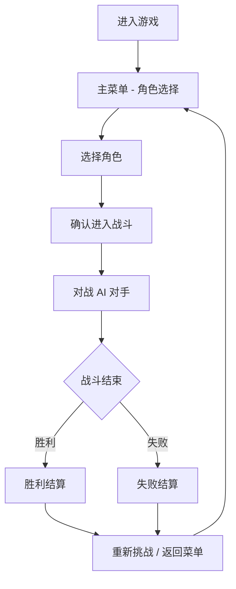

## 1. 产品概述

咒术回战：咒力交织 — 基于咒术回战 IP 的浏览器端 2D 动作格斗游戏，还原原作角色术式、领域展开等核心战斗机制，提供单人 PvE 对战与角色选择体验。

- 目标用户：咒术回战动漫粉丝、二次元动作玩家、格斗游戏爱好者
- 核心价值：在浏览器中体验咒术回战式的硬核格斗，无需下载，即开即玩

## 2. 核心功能

### 2.1 用户角色

| 角色 | 说明 |
|------|------|
| 玩家 | 选择角色进行对战，无需注册 |

### 2.2 功能模块

1. **主菜单/角色选择页**：选择角色、查看角色属性、进入战斗
2. **战斗页面**：2D 格斗对战，包含攻击、技能、闪避、领域展开
3. **结算页面**：战斗结果展示、重新挑战

### 2.3 页面详情

| 页面名称 | 模块名称 | 功能描述 |
|----------|----------|----------|
| 主菜单 | 角色选择 | 展示 4 名可选角色（虎杖、伏黑、钉崎、五条），含角色立绘与属性面板 |
| 主菜单 | 模式选择 | 选择 PvE 对战模式 |
| 战斗页 | 战斗画布 | Canvas 2D 格斗场景，双方血条、咒力值、状态显示 |
| 战斗页 | 操作面板 | 移动/跳跃按钮、普攻、技能1、技能2、闪避、领域展开按钮 |
| 战斗页 | HUD | 实时显示双方血量、咒力值、连击数、Buff 状态 |
| 结算页 | 胜利/失败 | 展示战斗结果、伤害统计、重新挑战按钮 |

## 3. 核心流程

## 4. 用户界面设计

### 4.1 设计风格

- **主色调**：深紫黑底（#1a0a2e）+ 咒力蓝紫渐变（#6c3ce0 → #00d4ff）
- **强调色**：咒力青（#00d4ff）、赤红（#ff2d55）、金色（#ffd700）
- **字体**：标题使用锐利日系风格字体，正文使用开源无衬线字体 Noto Sans SC
- **布局**：全屏沉浸式，战斗界面覆盖式 HUD
- **特效**：粒子系统、光晕、屏幕震动、斩击轨迹

### 4.2 页面设计概览

| 页面名称 | 模块名称 | UI 元素 |
|----------|----------|----------|
| 主菜单 | 背景 | 暗色渐变背景 + 咒力粒子飘浮 + 标题 logo |
| 主菜单 | 角色选择 | 4 角色卡片横向排列，悬停放大，选中高亮发光 |
| 主菜单 | 开始按钮 | 居中大按钮，咒力蓝紫渐变，脉冲动画 |
| 战斗页 | 场景 | 夜晚城市街道背景，像素风格或渐变天空 |
| 战斗页 | 血条 | 顶部双方血条 + 咒力值条，角色头像 |
| 战斗页 | 操作区 | 左下移动摇杆，右下攻击/技能/闪避/领域按钮 |
| 结算页 | 结果 | 居中大字胜利/失败，统计数据，按钮 |

### 4.3 响应式

- 桌面端优先，Canvas 适配 16:9 比例
- 移动端触控操作适配（虚拟摇杆 + 按钮）
- 最小支持 375px 宽度

### 4.4 2D 战斗场景设计

- 场景：夜晚废弃城区，远处建筑剪影，咒力蓝紫粒子飘浮
- 角色：Canvas 绘制二次元风格角色，含攻击动画帧
- 特效：斩击轨迹线、黑闪爆炸粒子、领域展开全屏滤镜
- 音效：打击音效、技能音效、BGM（可选，使用 Web Audio API）