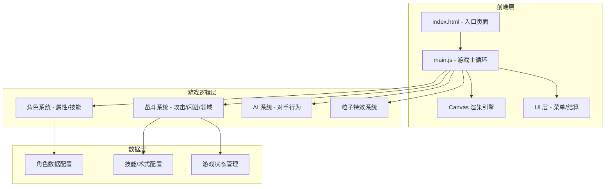

## 1. 架构设计



## 2. 技术选型

- **前端**：原生 HTML5 + Canvas 2D + JavaScript (ES6+)
- **构建工具**：无需构建，纯静态页面
- **后端**：无，纯前端单机游戏
- **数据存储**：localStorage（记录最高分/战绩）
- **音效**：Web Audio API 生成打击音效
- **字体**：Google Fonts - Noto Sans SC + 自定义 CSS 字体

## 3. 路由定义

| 路由 | 用途 |
|------|------|
| 单页面应用 | 通过状态切换实现菜单/战斗/结算页面切换 |

## 4. 核心数据模型

### 4.1 角色数据结构

```typescript
interface Character {
  id: string;
  name: string;
  title: string;
  maxHp: number;
  attack: number;
  defense: number;
  speed: number;
  maxCursedEnergy: number;
  skills: Skill[];
  ultimate: UltimateSkill;
  passive: string;
  color: string; // 主题色
}

interface Skill {
  name: string;
  damage: number;
  cost: number;
  cooldown: number;
  description: string;
  type: 'melee' | 'ranged' | 'summon' | 'buff';
}
```

### 4.2 游戏状态

```typescript
interface GameState {
  phase: 'menu' | 'fighting' | 'result';
  player: FighterState;
  enemy: FighterState;
  combo: number;
  timer: number;
  winner: 'player' | 'enemy' | null;
}

interface FighterState {
  character: Character;
  currentHp: number;
  cursedEnergy: number;
  position: { x: number; y: number };
  velocity: { x: number; y: number };
  state: 'idle' | 'moving' | 'attacking' | 'hit' | 'blocking' | 'casting';
  cooldowns: Record<string, number>;
  buffs: Buff[];
}
```

## 5. 角色配置

| 角色 | 类型 | 特点 |
|------|------|------|
| 虎杖悠仁 | 近战强攻 | 高血量、黑闪暴击、普攻连段强化 |
| 伏黑惠 | 召唤拉扯 | 式神协同、远程牵制、灵活性高 |
| 钉崎野蔷薇 | 远程术式 | 稻草人远程、破甲、群体伤害 |
| 五条悟 | 全能天花板 | 无敌屏障、苍/赫/茈、领域无量空处 |

## 6. 文件结构

```
/workspace/
├── index.html          # 入口页面
├── css/
│   └── style.css       # 样式
├── js/
│   ├── main.js         # 游戏主入口与循环
│   ├── canvas.js       # Canvas 渲染引擎
│   ├── characters.js   # 角色数据配置
│   ├── fighter.js      # 战斗单位逻辑
│   ├── combat.js       # 战斗系统
│   ├── ai.js           # AI 对手
│   ├── particles.js    # 粒子特效
│   ├── ui.js           # UI 渲染
│   └── audio.js        # 音效
└── assets/
    └── (无外部素材，全部代码绘制)
```